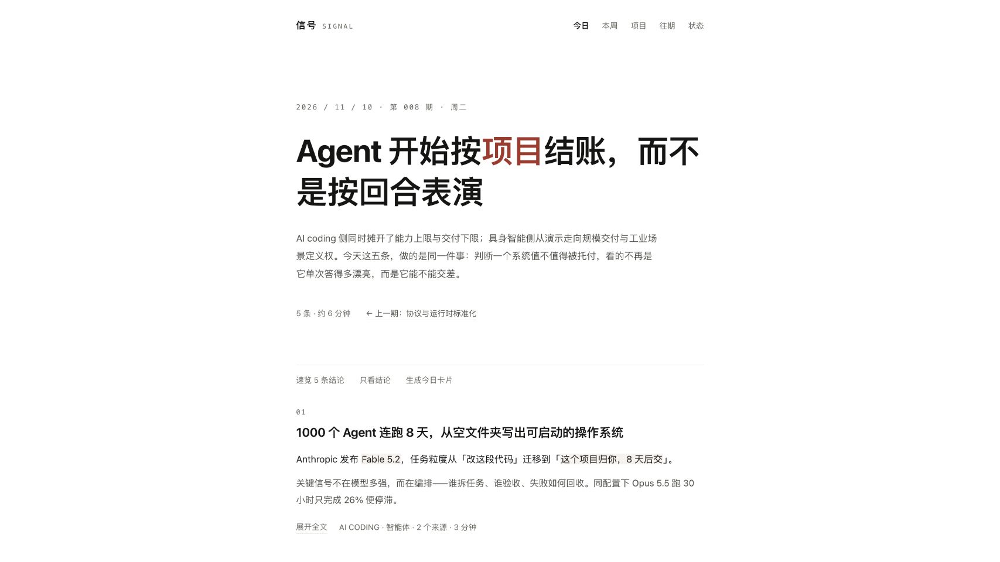
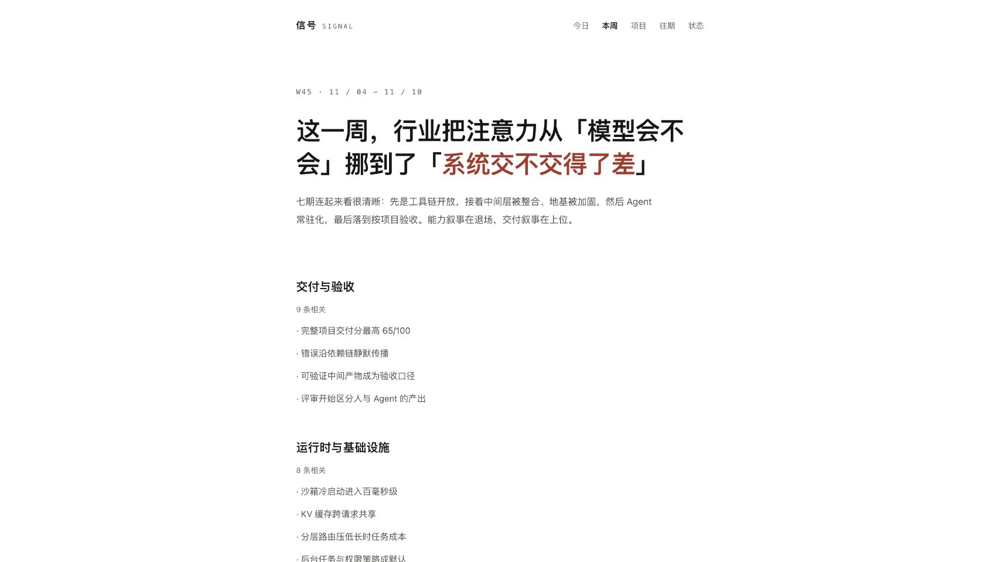
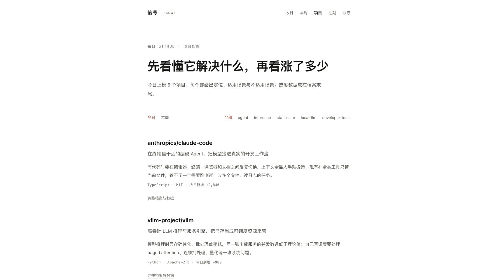
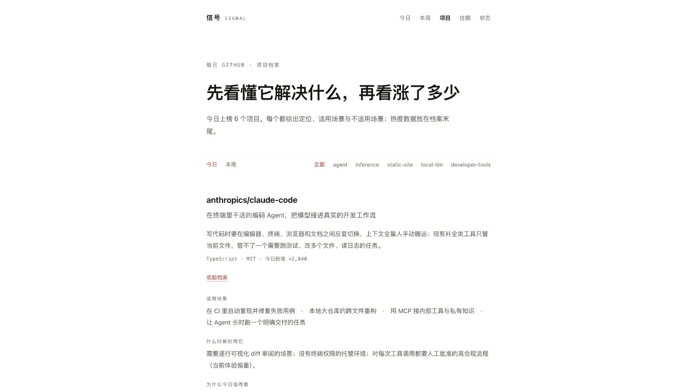
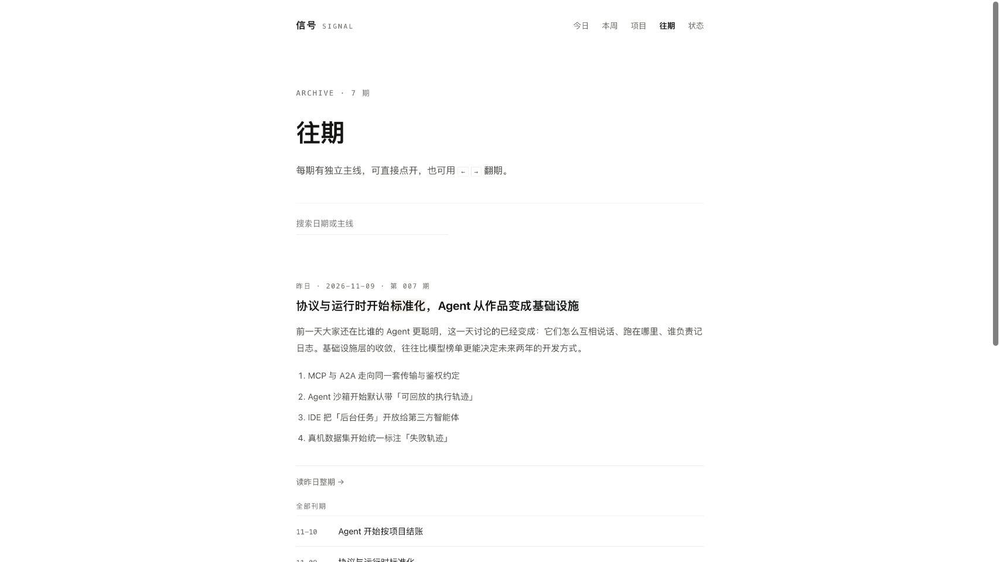
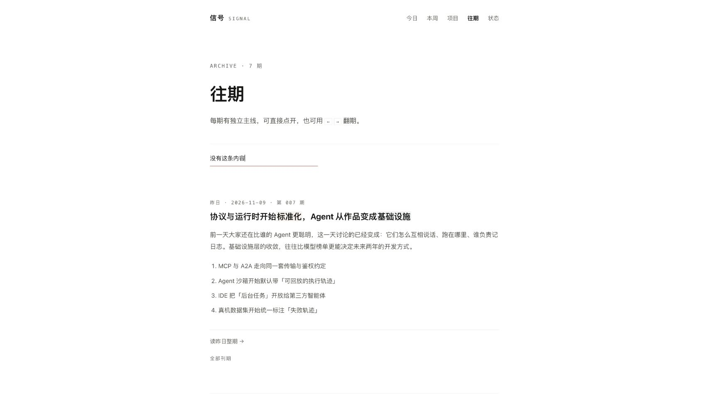
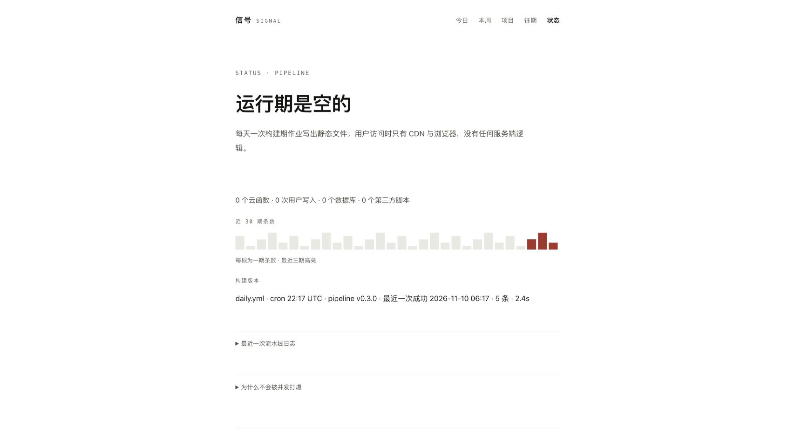
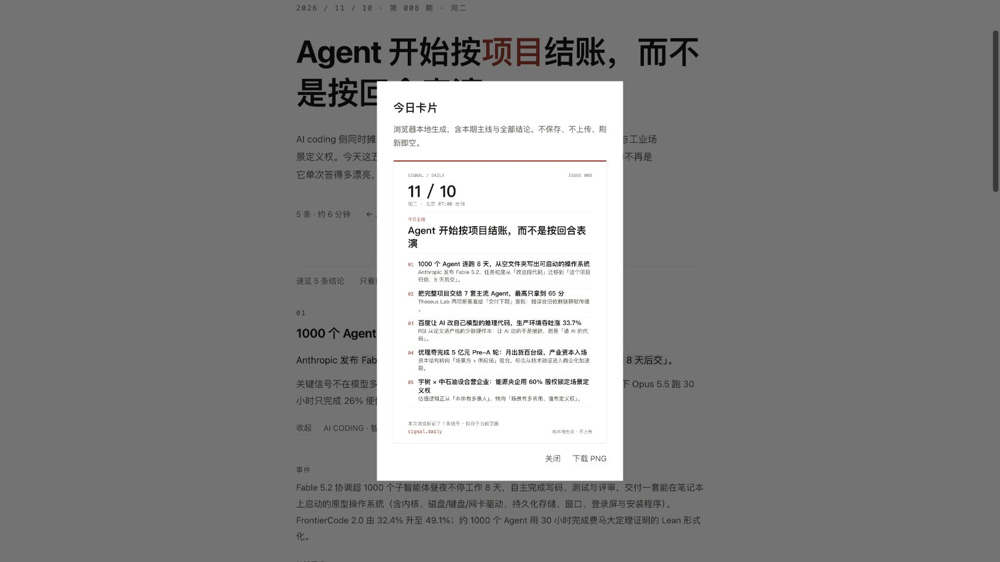

# 原型实际检查记录

> 2026-11-10｜候选 v0.3，未定稿。只读检查，未修改原型代码。

## 检查环境与边界

入口为仓库内 `prototype/index.html`，通过绑定 `127.0.0.1` 的本机 HTTP 服务打开。使用 Codex 内置浏览器，逐页查看截图与可访问性树，并操作部分核心控件。

桌面截图为浏览器默认大小；窄屏尝试设置 390×844 后，页面实际报告 CSS 视口为 **520×1125**，因此本轮只能说明在该窄屏检查过，不能声称 390px 或真机通过。窄屏截图已在页面滚回顶部后重拍。

本轮没有执行完整 39 项测试、无 JS、完整键盘遍历、深色、下载文件验证、真实来源核验、生产集成或 Lighthouse。演示数据中的新闻、项目数字与日志均未作为真实事实验证。

## 页面与流程

| 步骤 | 操作 | 观察到的结果 | 状态 |
|---|---|---|---|
| 1 今日首屏 | 打开页面并查看首屏 | 大标题、长导语和留白先于具体条目；三种阅读入口同时存在 | 已查看，产品与视觉待评审 |
| 2 本周 | 从导航进入本周并查看 | 三主题长文、七期主线、曲线和项目短名单；首屏仍沿用大标题与大留白 | 已查看，主题证据链未完成验证 |
| 3 项目 | 进入项目、展开首项目 | 介绍完整度高于只列 star；展开出现大量小标签，仓库入口位于展开末尾 | 展开有效，层级与入口待评审 |
| 4 项目外链 | 点击“打开仓库” | 原页弹“演示原型：将打开 github.com/anthropics/claude-code”，没有导航到仓库 | 占位，不能算真实外链通过 |
| 5 往期 | 进入往期、输入“没有这条内容” | 刊期列表被隐藏，固定昨日摘要仍显示，没有无结果说明 | 搜索反馈不完整 |
| 6 状态 | 从导航进入状态 | 架构说明、30 期图、成功时间和日志；页脚注明演示数据 | 已查看，不能证明线上健康 |
| 7 正文详情 | 今日首条展开 | 出现事件、事实、场景、边界、来源和四类标记；来源显示为纯文字域名描述 | 展开有效，真实来源链接未实现 |
| 8 标记到分享 | 标记首条“想试”，打开今日卡片 | 预览仍含整期五条，仅附标记 1 条的总数 | 与“选择卡片条目”描述不一致 |
| 9 窄屏 | 调整视口、重载、回到顶部 | 导航换行，导语与工具行仍占较长篇幅，具体首条出现在其后 | 520 CSS px 已查看，390px 未验证 |

## 需要先解决的问题

1. **产品规则互相冲突**：标记到底用于选条、附注还是纯反馈，没有统一；需要先定规则再写测试。
2. **演示动作不等于完整功能**：打开仓库、RSS 和日历是占位 toast；来源为文字。首期交付必须到达实际资源。
3. **搜索的状态不完整**：零匹配后仍显示大块昨日摘要，读者难判断搜索是否生效。
4. **首屏减装饰不等于阅读顺序合理**：今日、本周、项目都使用大标题/长引言再到具体内容；需要按任务比较版面，而不是靠固定字号比例判断。
5. **信息分层还要评审展开态**：项目展开后仍堆叠“适用场景、什么时候别用、为什么今日、事实、主题、同类”等标签；不能只看折叠首屏就宣布简洁。
6. **可访问性风险**：可访问性树中部分列表跳转仍是普通文本/容器，来源不是链接，弹层未显示为具名 dialog。完整键盘、焦点与屏幕阅读器检查仍待做，不能从截图宣称合规。

## 源码补充证据（与视觉观察分开）

- `render()` 使用 `innerHTML` 注入页面，当前并非生产需要的静态 HTML 正文；禁用 JS 验证尚未执行。
- `drawCard()` 遍历 `issue().items`，标记只计算总数；不是根据所选条目生成。
- `areaChart()` 使用固定数组，`densityStrip()` 用循环公式造柱高；这些是演示图，不是计算后的真实统计。
- 点击任何周报项目短名单只切换到项目总页，不带对应项目身份。
- 当前项目无 package、生产源码、CI 与测试配置；历史“39/39”缺少可复跑材料。

## 截图证据

以下均为本轮浏览器实拍并已查看；不含设计重绘。截图中的新闻、模型名称、数字和状态仅为原型演示内容。

### 1 今日首屏

### 2 本周

### 3 项目默认与展开

### 4 往期与零结果

### 5 状态

### 6 分享卡

### 7 窄屏

## 当前结论

原型可访问并有多页与部分有效交互，但仍是产品和工程准备材料。下一步按产品基线 D01–D07 形成明确方案，重做需要调整的原型状态，用户确认后再落地对应生产代码。
